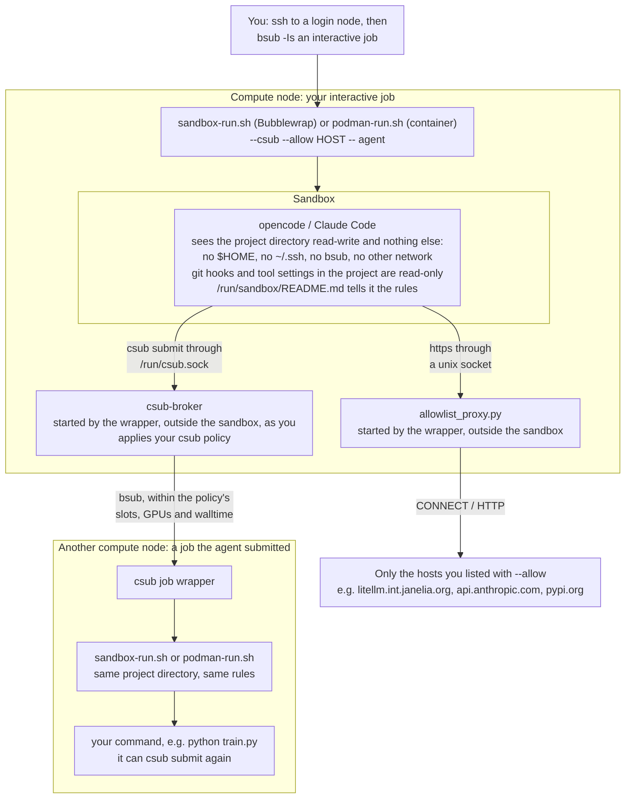
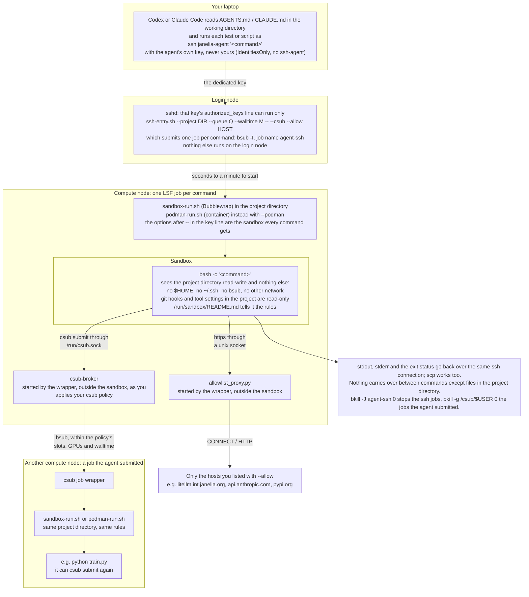

# agentic-sandbox

Sandboxing for unsupervised agentic loops on Janelia's LSF cluster. Two wrappers with nearly the
same flags:

- **`scripts/sandbox-run.sh`** — Bubblewrap (`bwrap`). No root, no daemon, no image. The default.
- **`scripts/podman-run.sh`** — rootless Podman, for a task that needs a container image (CUDA
  toolkit, cuDNN, PyTorch). GPU access alone does not need it; see
  [GPU work: bwrap or podman](#gpu-work-bwrap-or-podman).

They exist because internal guidance requires that an agentic loop running without a human
reviewing each step has its file, device and network access restricted to what the task needs, and
that agent-generated code never runs with a user's full permissions. Everything here has been tested
live on the cluster as an ordinary user account.

**Which document:** [`SETUP.md`](SETUP.md) first (one-time, per account) · this README to use the
wrappers · [`CHANGELOG.md`](CHANGELOG.md) for behaviour changes · [`config/`](config/) for the files
setup copies. The reasoning behind each decision is in the comments of the scripts, next to the code
it explains.

**Which setup:**

| Where the agent runs | What you use | Read |
| --- | --- | --- |
| On the cluster, with you watching | a wrapper inside an interactive job | [Quick start](#quick-start) |
| On the cluster, unattended | a wrapper as a batch job | [Quick start](#quick-start), modes A and B |
| On your laptop, with the work on the cluster | `scripts/ssh-entry.sh` behind a dedicated ssh key | [An agent on your laptop](#an-agent-on-your-laptop-the-work-on-the-cluster-ssh-entrysh) |

**In short:** the agent sees only the directories you bind in (the one you start from is read-write),
reaches only hosts you `--allow`, sees none of your shell environment, and works on a throwaway copy of
its own config. What it writes into a read-write directory outlasts the job; see [what it does and does
not protect against](#what-it-does-and-does-not-protect-against).

## Before you start

| To use | You need once | See |
| --- | --- | --- |
| `sandbox-run.sh` (bwrap) | a clone of this repo; nothing else | `SETUP.md` §1–2 |
| `--claude` | `claude auth login` outside the sandbox | `SETUP.md` §4 |
| `--opencode` | opencode installed and run once, and a LiteLLM key for `kimi-k3` from HPC | `SETUP.md` §5 |
| `sandbox-run.sh --gpu` | nothing more; run it inside an LSF GPU job | `SETUP.md` §2 |
| `podman-run.sh` (a container image) | a subuid/subgid range from HPC (**not self-service, ask first**), plus `storage.conf` and `containers.conf` from `config/` | `SETUP.md` §3 |
| `--csub` (optional) | csub installed and a policy, written by `scripts/csub-policy.sh` | `SETUP.md` §6 |
| `ssh-entry.sh` (an agent on your laptop) | a dedicated ssh key, one line in `~/.ssh/authorized_keys`, and normally `--csub` | `SETUP.md` §8 |

## Try it first (no login or key needed)

From an interactive job (`bsub -q interactive -Is /bin/bash`), with `SANDBOX` pointing at this repo's
`scripts/` directory:

```bash
SANDBOX=/path/to/agentic-sandbox/scripts
mkdir -p /scratch/$USER/work && cd /scratch/$USER/work      # a work dir, not this checkout

# 1. Your home is not there and there is no network:
"$SANDBOX"/sandbox-run.sh --scratch -- bash -c 'ls -A "$HOME"; curl -sS -m 5 https://example.com'
#    -> "ls: cannot access '<your home>': No such file or directory", then "Could not resolve host"

# 2. The directory you started in is writable, and one allowed host is reachable:
"$SANDBOX"/sandbox-run.sh --scratch --allow example.com -- bash -c \
  'touch ok.txt && echo wrote-ok; curl -sS -o /dev/null -w "%{http_code}\n" https://example.com'
#    -> wrote-ok, 200   (an un-allowed host answers 000)
```

## Quick start

```bash
# opencode + Kimi K3, one-shot
"$SANDBOX"/sandbox-run.sh --scratch --opencode --allow litellm.int.janelia.org -- \
  opencode run "who am I speaking to?" --model litellm/kimi-k3

# Claude Code, interactive session
"$SANDBOX"/sandbox-run.sh --scratch --claude \
  --allow api.anthropic.com --allow claude.ai --allow platform.claude.com -- claude

# the same on a GPU node (8 slots per GPU on gpu_l4): with the host's driver under bwrap ...
bsub -q gpu_l4 -gpu "num=1" -n 8 -Is /bin/bash
"$SANDBOX"/sandbox-run.sh --gpu --scratch --claude \
  --allow api.anthropic.com --allow claude.ai --allow platform.claude.com -- claude
# ... or in a container image that brings CUDA, cuDNN and PyTorch
"$SANDBOX"/podman-run.sh --gpu --scratch --claude \
  --allow api.anthropic.com --allow claude.ai --allow platform.claude.com -- claude
```

**A hang or endless `Request timed out` retries means a missing `--allow`**: there is no network by
default and these clients don't fail fast. On a non-zero exit the wrapper prints the denied hosts.

The sandbox is identical in the three ways to run it; only the submission differs:

- **A — one-shot.** A single command as a plain `bsub` job, submitted from a project directory on
  shared storage (not from `$HOME`, where the wrapper refuses to start). This is the unsupervised
  case the policy targets:
  ```bash
  bsub -q short -o out.log "$SANDBOX/sandbox-run.sh --scratch --opencode --allow litellm.int.janelia.org -- \
    opencode run 'who am I speaking to?' --model litellm/kimi-k3"
  ```
- **B — loop.** As A, looping over tasks inside one sandbox (state persists between iterations; for
  isolation submit one sandbox per iteration).
- **C — interactive.** `bsub -Is`, then a REPL. A human is present, so the sandbox is defence in depth.

## Adapting your project

- **Start from the directory the agent may change.** `$PWD` is the only read-write path by default.
  Don't start from `$HOME` or a directory above it (`sandbox-run.sh` refuses; `podman-run.sh` does
  not mount the working directory at all) or from this checkout (the wrapper re-binds its own
  directory read-only if you do).
- **Data in, results out.** `--ro /groups/lab/reference-data` for inputs, `--rw
  /groups/lab/project/results` for outputs: specific subdirectories, never `$HOME`. Write results to
  durable storage. `/scratch` is node-local and wiped hourly on nodes where you have no job, so a
  result left there can vanish, and a batch job on another node won't see files from your
  interactive session.
- **Code in.** Copy or `git clone` it into the work directory. Use git to review what the agent
  changed afterwards.
- **Dependencies.** Install them beforehand into a venv under a path you bind `--ro`, so the agent
  can't change it. A venv records the interpreter that built it, so build it with the Python the
  sandbox will use, in a directory that exists (`mkdir -p /groups/lab/venv`). For podman, inside the
  image (verified with the gpu image, `--image ghcr.io/janeliascientificcomputingsystems/agentic-sandbox-gpu:latest`):
  `podman-run.sh --keep-id --rw /groups/lab/venv --allow pypi.org --allow files.pythonhosted.org -- bash -c
  'python3 -m venv --system-site-packages /groups/lab/venv && /groups/lab/venv/bin/pip install PKG'`.
  `--system-site-packages` keeps torch and the rest of the image. For bwrap, build it with the host's
  `python3` the same way (`sandbox-run.sh --rw /groups/lab/venv --allow pypi.org --allow
  files.pythonhosted.org -- bash -c 'python3 -m venv /groups/lab/venv && /groups/lab/venv/bin/pip
  install PKG'`; verified with PyTorch, about 6 GB and four minutes; install `numpy` with `torch`, or
  every run warns `Failed to initialize NumPy`).
- **Git.** Credentials (`~/.ssh`, `.git-credentials`) aren't bound, so the agent can commit locally
  but can't push or clone private repos. Push from outside after reviewing.
- **Treat what the agent wrote as untrusted.** Files in a read-write directory persist after the job.
  The ones tools run by themselves (`.git/hooks/*`, project-level `.claude/settings.json`,
  `.mcp.json` and the like) are read-only inside when they existed at start, and new ones are named
  at exit ("Files that run later"). The code itself is the agent's to change: review it before you
  build or run it outside the sandbox.
- **Resuming a Claude session.** The per-job config starts without history, so `claude --resume` and
  `--continue` find nothing. `--claude-history` (with `--claude`, `sandbox-run.sh` only) binds the
  past sessions of the directory you start from, and only those, read-only; the conversation can be
  continued but the new turns are not kept. `--claude-history-rw` keeps them, and lets the agent
  edit the old transcripts. Either way the agent can read everything said in those earlier
  sessions, including ones you ran outside the sandbox from the same directory.
- **Another harness?** Find where it keeps config and state, grant those paths with `--rw`/`--ro`,
  and `--allow` the domains its model needs.

```bash
cd /groups/lab/project/agent-work            # the one directory the agent can change
"$SANDBOX"/sandbox-run.sh --claude --ro /groups/lab/reference-data \
  --allow api.anthropic.com --allow claude.ai --allow platform.claude.com -- claude
```

## How the sandbox works

**Filesystem, default-deny.** Only what is bound exists inside. Always bound: the toolchain
(`/usr /bin /lib64 /lib /sbin /etc`) read-only and `$PWD` read-write (bwrap), or just the `-v` mounts
you name (podman, whose cwd is the image's `WORKDIR`). `$HOME` is bound only if you ask. `/tmp` is a
private tmpfs (bwrap) or the container's own (podman). The more specific path keeps its
own mode, whatever the flag order: a `--rw` inside a `--ro` tree is writable for that subtree only,
and a `--ro` inside a `--rw` tree (or inside `$PWD`) stays read-only.

**Credential masking (bwrap only).** Directly under every bound root (`$PWD`, `$HOME` if bound, every
`--ro`/`--rw`/`--scratch` path), `.ssh`, `.aws`, `.azure`, `.kube`, `.config/gcloud`, `.docker` and others
appear as empty directories, and `.git-credentials`, `.npmrc`, `.pypirc`, `.netrc`, `.env`,
`.env.local` and others as empty files. The same names under `$HOME` are masked
whenever they are inside a bound root (from `~/.config`, `gcloud/` is empty), and a root that is one
of those `$HOME` locations, or inside one, is refused, as is `~/.claude` itself read-write. Only
paths that exist at start are masked, and under a project root only direct children: a `.env` two
levels down is readable. The full list is in the sandbox's own `/run/sandbox/README.md`.
Podman can't do this (a `--tmpfs` can't shadow a path under an ancestor `-v` bind), so
`podman-run.sh` refuses `--rw`/`--ro` on a path that is or contains `$HOME`, on a credential directory
under it (`~/.ssh`, `~/.aws`, `~/.claude`, ...) or a directory that contains one (`~/.config`); another
subdirectory is fine,
and on one that contains `/scratch/$USER/.agentic-sandbox`.

**Network, default-deny.** Without `--allow` there is no network. `scripts/allowlist_proxy.py` runs
outside the sandbox on a Unix socket and allows `CONNECT`/HTTP to the listed hostnames and their
subdomains, **on any port**, refusing everything else. A listed name is not trusted to point
anywhere: the proxy resolves it and refuses it (403) when it resolves to a loopback, link-local
(169.254), multicast or reserved address, so an allowed name cannot be used to reach services on
the node. Private addresses are allowed, since the cluster's own services have them. The socket is bound into the sandbox and
`scripts/relay.py` exposes it on loopback; `http_proxy`/`https_proxy` (both cases) and `no_proxy` are
set. There is no direct route out: no raw TCP, no package registries you didn't list. But a
listed host is reachable on any of its ports, so list only hosts you'd accept that for. No SOCKS5, deliberately: Claude Code only speaks HTTP proxies.

**Environment (bwrap).** The sandbox starts empty. Only `PATH`, `HOME`, `USER`, `LOGNAME`, `SHELL`,
`TERM`, `COLORTERM`, `LANG`/`LC_*`, `TZ` and the CA-bundle variables come through, plus anything named
with `--env`. LSF forwards your whole shell environment into a job, so otherwise an exported
`ANTHROPIC_API_KEY`, `HF_TOKEN` or `AWS_*` would be readable by the agent. Podman forwards no host
environment. When stdin is not a terminal the bwrap sandbox gets its own session (`--new-session`) so
it can't type into your terminal.

**Files that run later are read-only.** Some files in a project are instructions to tools, not
work product: git runs `.git/hooks` and what `.git/config` names, Claude Code loads `.mcp.json` and
`.claude/`, an editor runs `.vscode` tasks, pre-commit runs what `.pre-commit-config.yaml` lists. A
process that can write them gets code run later, as you, outside the sandbox, the next time you use
git or open the project. Where they exist directly under a read-write directory, both wrappers bind
them read-only: `.git/hooks`, `.git/config` and a hooks directory it names, `.mcp.json`,
`.claude/{settings.json,settings.local.json,commands,agents,hooks,skills}`, `.vscode`,
`.devcontainer`, `.husky`, `.codex`, `.opencode`, `opencode.json` and `.pre-commit-config.yaml`.
`.git` and `.claude` themselves are pinned, so they cannot be moved aside and rebuilt. Commits,
branches and everything else in git still work. `git config` and `git remote add` in an existing
repository do not, nor does editing `.claude/settings*.json`: do those outside, or start with
`--no-protect`. Your git identity is passed in as `GIT_AUTHOR_*` and `GIT_COMMITTER_*`, taken from
your global git configuration when it has one. What does not exist at start
cannot be protected: if the command creates one of these, the wrapper names it at exit (a new
repository is named once, as `.git`), and it is protected from the next start on. Only the
top level of each read-write directory is covered, like the credential masks. `--no-protect` turns
all of this off.

**See what a run would do, and what it did.** `--dry-run` goes through every check and prints the
`bwrap` or `podman` command, the proxy and broker it would start, and (for bwrap) the environment the
command would get, without starting the sandbox, the proxy or the broker; values passed with `--env`
are not shown. After a real run in which the proxy saw a request or csub recorded a job, a record is in `~/.agentic-sandbox/records/<date>/<job>.log`:
the command, its exit status, every host the proxy allowed or refused with the time, and the csub
jobs recorded while the sandbox ran. `$HOME` is not bound into the sandbox unless you bind it yourself,
so the sandboxed process cannot change a record. `SANDBOX_RECORD=off` in the environment turns it off, and nothing removes
old records.

**Harness config is copied, not bound.** `--claude` gives the sandbox a per-job copy of
`~/.claude.json`, `~/.claude/settings.json` and `~/.claude/CLAUDE.md`, with `CLAUDE_CONFIG_DIR`
pointing at it; only `~/.claude/.credentials.json` is bound through, so logins and token refreshes
persist. `--opencode` copies `~/.config/opencode` and binds its three data dirs (`~/.local/share/opencode`,
`~/.local/state/opencode`, `~/.cache/opencode`) read-write. Why: hooks, MCP entries and plugins are commands the harness
runs *as you, outside the sandbox, in your next session*; an agent that could write them would have a
way out that outlives the job. Edits to the copies die with the job. Under bwrap the CLI binaries are bound
read-only and put on `PATH`; under podman they come from the image.

**Per-job state.** Everything a run creates (config copies, proxy and broker sockets, the generated
in-sandbox README, under podman the image store) lives in
`/scratch/$USER/.agentic-sandbox/<LSB_JOBID>[-<LSB_JOBINDEX>]-<pid>/` (mode 700), removed whole at
exit, also on `bkill` and walltime kills (the record above is kept). Nothing goes to `/tmp`. That is why `--scratch` binds
`/scratch/$USER/work`, not `/scratch/$USER`: the whole tree would expose every concurrent job's state,
including a sibling's proxy socket with a different allowlist. bwrap masks `.agentic-sandbox/` if a
bound root contains it; podman can't, so it refuses a bind of `/scratch/$USER` itself.

**The agent is told all this.** Every sandbox contains `/run/sandbox/README.md` (`$SANDBOX_README`),
generated from the actual invocation: mounts and modes, reachable hosts, environment and, with
`--csub`, the job-submission policy. With `--claude` the per-job `CLAUDE.md` points to it, so the agent
stops probing for paths, hosts or images that don't exist for it.

## Submitting cluster jobs from inside the sandbox (`--csub`)

A sandboxed agent must not hold `bsub`: anything it submitted would run on the cluster outside any
sandbox. `--csub` closes that gap with [csub](https://github.com/saalfeldlab/csub), Stephan
Saalfeld's policy-checked job broker, over the same socket bridge `--allow` uses:



- The wrapper starts `csub-broker --serve` outside the sandbox, as you, and stops it at exit; only its
  socket crosses the boundary, at `/run/csub.sock`.
- Inside, `csub` and `import csub` work with the sandbox's own `python3` (the csub package is
  bound read-only on `PYTHONPATH`, a shim is on `PATH`). `CSUB_TRANSPORT`, `CSUB_SOCKET` and `CSUB_MOUNTS` are set;
  `CSUB_MOUNTS` comes from `$PWD` (under `sandbox-run.sh`, always) and the `--rw`/`--ro` paths not under
  `$HOME` or `/scratch` (nested ones dropped); a preset `$CSUB_MOUNTS` may only narrow that list, and the wrapper refuses one that
  does not. With a `--ro` directory inside a `--rw` one, the outer directory is passed to csub as
  read-only (csub cannot express the nesting), so `csub submit` from inside it is refused: submit
  from a read-write directory that has no read-only part.
- The broker applies **your** `~/.config/csub/broker.toml` (roots, images, hosts, queues, limits); the
  agent gets a job id or a `policy_violation`. Child jobs run through these wrappers (`sandbox =
  "podman"` or `"bwrap"` in the policy) and can submit again. GPU children under `sandbox = "bwrap"`
  need a csub with PR #15, merged 2026-11-15 (tested against `main` at `ec9aa88`; an older csub refuses them).
  `scripts/csub-policy.sh` writes the policy, including `sandbox_scripts_dir`, which must point at this
  checkout's `scripts/`. `--gpu` on the parent
  sandbox is independent: it changes neither the mounts nor the hosts in the envelope.
- **The agent controls `CSUB_MOUNTS` inside the sandbox**, but the broker is started with this
  sandbox's mounts and `--allow` hosts as its envelope (csub #13), so a child job cannot mount a
  directory the sandbox itself can't see, or reach a host it can't. With nothing to put in the
  envelope (podman with only `/scratch` mounted and no `--allow`, say) or a csub without it, the
  wrapper refuses to start; `CSUB_ENVELOPE=off` accepts a broker bounded by the policy alone. Keep
  `allowed_roots` as narrow as the project either way.
- Needs `csub-broker` on `PATH` at start and a policy (`SETUP.md` §6). `CSUB_BROKER_CMD` names
  another broker command; anything but the `csub-broker` command itself is started from `/`, so a
  relative `--policy` path in it does not resolve. Without `bsub` on the host,
  `--csub` fails at start; csub's `csub relay` is the tool for that case.
- **The limits are per job, checked at submit.** A job asks for slots, GPUs and a walltime; the broker
  refuses one above `max_slots`, `max_gpus` or `max_walltime_min`. `max_estimated_cost_usd` is the same
  kind of check, not a budget: the estimate is the slots and GPUs times the walltime asked for, at the
  prices in the policy, and nothing is added up across jobs. `max_pending_per_session` caps how many
  jobs wait at once. All GPUs of one job come from one node.

```bash
export PATH=~/.venvs/csub/bin:$PATH
cd /groups/<your-allowed-root>/project
"$SANDBOX"/sandbox-run.sh --csub --claude \
  --allow api.anthropic.com --allow claude.ai --allow platform.claude.com -- claude
# inside:  csub probe · csub submit --walltime 30 [--gpus 1 -q gpu_l4] [--wait] -- python train.py
#          csub status · csub logs <id> · csub kill <id>     (output: <cwd>/.csub/jobs/<id>/stdout)
```

Verified live on both wrappers: probe, submit with wait (child in its own container on another node),
status, a policy rejection as exit code 3, and a child submitting a grandchild. Nothing left behind.

## An agent on your laptop, the work on the cluster (`ssh-entry.sh`)

An agent on a laptop that reaches the cluster with your ordinary ssh key acts as you on a login node:
no sandbox, and work on a node where none is allowed. `scripts/ssh-entry.sh` closes that. The agent
gets its own ssh key, and one line in `~/.ssh/authorized_keys` on the cluster ties that key to the
script, so the key can do nothing else:

```
command="env PATH=$HOME/.venvs/csub/bin:$PATH $HOME/agentic-sandbox/scripts/ssh-entry.sh --project /groups/lab/project --queue interactive --walltime 60 -- --csub",no-port-forwarding,no-agent-forwarding,no-X11-forwarding,expiry-time="20271231" ssh-ed25519 AAAA... agent
```



- **Each `ssh janelia-agent '<command>'` is one LSF job** (`bsub -I`, job name `agent-ssh`) whose command is
  `sandbox-run.sh` started in the project directory. stdin, stdout, stderr and the exit status are
  relayed, each on its own stream, so `scp` to the project directory works too, with `--podman` as well
  (tested through the forced command, not yet through a real sshd). A job takes from seconds to a minute to
  start, and nothing carries over between commands except files in the project directory.
- **Only the script and `bsub` run on the login node.** The agent's command reaches the compute node
  in the job's environment, not on a command line.
- **`--project DIR`** is the one directory the agent can read and write. It must exist and be
  outside `$HOME`; `ssh-entry.sh` refuses your home directory and anything inside or above it. `--queue`, `--slots` (default 1) and `--walltime` (minutes, default 240) shape the job each
  command runs in. `--podman` runs the command through `podman-run.sh` in a container image, with
  the project bound read-write at the same path; it needs `SETUP.md` §3.
- **Options after ` -- ` go to the wrapper unchanged**: `--csub`, `--allow HOST`, `--ro DIR`, `--gpu`,
  and for podman `--image NAME`. They are the sandbox every command gets.
- **A host or directory has to be allowed twice** when jobs go through `--csub`: here in the key line,
  and in the csub policy (`csub-policy.sh --allow HOST --ro DIR`). A job the agent submits must pass
  the policy and stay inside the sandbox it was submitted from; with only one of the two, csub
  answers `not allowed in the parent job`.
- **Tell the agent.** It runs outside the sandbox and cannot know the rules unless told. `config/` has
  the instruction file to put in the agent's working directory on the laptop: `CLAUDE.md` for Claude
  Code, `AGENTS.md` for Codex (`AGENTS-podman.md` with `--podman`, saved under either name). They point the agent at
  `$SANDBOX_README`, the sandbox's own description, with `ssh janelia-agent 'cat $SANDBOX_README'`.
- **To stop it:** `bkill -J agent-ssh 0` ends the ssh sessions and `bkill -g /csub/$USER 0` the jobs it
  submitted. Deleting the key line cuts the agent off; `expiry-time` does the same by date (the
  date is the first day the key is refused).

What this does not change: the agent's own process runs on the laptop with whatever that harness
allows there. The sandbox bounds what it can do on the cluster, not on the laptop. Give the key no
passphrase only because the agent must use it unattended, never reuse a personal key for it, and
keep `IdentitiesOnly yes` and `IdentityAgent none` in the ssh alias so the agent cannot fall back to
yours. Setup, step by step: `SETUP.md` §8.

Verified live under bwrap, with Claude Code and Codex on a Mac between them: commands, `scp`, the denials (no
`~/.ssh`, no `bsub`, no network beyond `--allow`), `--ro`, `--allow`, and csub jobs up to 8 GPUs. The
`--podman` form has been run, but its `--ro` and `--allow` options have not been checked.

## Images (podman)

Neither is required; `--image` takes any OCI image (for `scp` through `ssh-entry.sh --podman` it
must have `sftp-server` at `/usr/libexec/openssh/sftp-server`). A csub policy decides which images child jobs may use.

| Image | Base | Contents | Size | Use when |
| --- | --- | --- | --- | --- |
| `ghcr.io/janeliascientificcomputingsystems/agentic-sandbox-lite:latest` (default, `podman/Dockerfile`) | `nvcr.io/nvidia/cuda:13.5.0-base-ubuntu22.04` | CUDA runtime libraries, Node.js, Claude Code, opencode, Codex, `git`, `rsync`, `python3` with `pip` and `venv`, `sftp-server` | about 2 GB | coding agent on a GPU node that isn't doing ML itself; `nvidia-smi` and the CUDA runtime API work, `nvcc`/cuDNN do not |
| `ghcr.io/janeliascientificcomputingsystems/agentic-sandbox-gpu:latest` (`podman/Dockerfile.pytorch`) | `nvcr.io/nvidia/pytorch:26.07-py3` | PyTorch 2.13, cuDNN, NCCL 2.30, Ray 2.60 (Train and Data), `gcc`/`g++`/`make`, `pip`/`venv`, `curl`/`wget`, `vim`, `jq`, `ssh`, `sftp-server`, plus the same CLIs | 26 GB | real ML work, native extensions, anything that needs PyTorch |

Both images carry `sftp-server`, so `scp` and `sftp` through `ssh-entry.sh --podman` work, and the
GPU image sends NVIDIA's start-up banner to stderr, so a command's stdout holds only its own output.
`podman-run.sh` checks for a newer image on every run (a digest check; a download only if it changed).
`--allow` needs `bash` and `python3` in the image for the in-container relay; a minimal image such as
`alpine` fails with `executable file /bin/bash not found`.

## Harnesses
Logging in and configuring are in `SETUP.md` §4–5. At run time:

- **Claude Code.** A fresh `claude auth login` inside the sandbox works only if
  `~/.claude/.credentials.json` already exists on the host. An API key beats an expired login; never
  put it on a `bsub` command line. Not carried in: `~/.claude/plugins`, skills, `projects/` history
  (under `sandbox-run.sh`, add `--ro`/`--rw` for a path a task needs, and `--claude-history` for this
  directory's history; `podman-run.sh` refuses paths inside `~/.claude`).
- **opencode + Kimi K3.** **Always name the model** interactively, `opencode -m litellm/kimi-k3`: bare
  `opencode` defaults to its hosted "OpenCode Zen" model, which talks to hosts outside your allowlist
  and fails with a bare `Forbidden`. One-shot `opencode run ... --model litellm/kimi-k3` is unaffected.
  Run **one opencode sandbox per account at a time**: its sqlite database on NFS is bound into every
  `--opencode` sandbox, and two concurrent ones race on it.
- **Unattended `opencode run` (Mode A/B).** opencode asks before reading outside its working
  directory and cannot ask in a batch job, so the read is auto-rejected and the model may give up and
  exit 0. The sandbox is the boundary, so allow it: `export
  OPENCODE_CONFIG_CONTENT='{"permission":{"external_directory":"allow"}}'` and pass `--env
  OPENCODE_CONFIG_CONTENT` to `sandbox-run.sh`. `podman-run.sh` has no `--env`; there the same permission would have to go
  into `~/.config/opencode/opencode.json`, which the wrapper copies into the container (not tested). An agent that gives up
  still exits 0, so check for the output you expect, not the exit code.
- **The Kimi K3 safeguard.** Requests to `kimi-k3` pass through a gateway guardrail (an LLM-as-judge
  for harmful content and jailbreaks) whatever the client. A refusal is either the gateway's
  `GuardrailRaisedException`/400 naming the check (`content_harm`) or the model declining in prose;
  both have been seen on the same prompt. It also blocks an answer that names cluster nodes or job ids
  (`sensitive_data_leak`), so ask for a result, not for where a job ran. Claude via Anthropic directly
  has no gateway guardrail.
  Treat either as a normal outcome, not a broken service.

## GPU work: bwrap or podman

Both wrappers take `--gpu` inside an LSF GPU job. **Use bwrap unless the task needs a container
image.**

| | `sandbox-run.sh --gpu` (bwrap) | `podman-run.sh --gpu` |
| --- | --- | --- |
| One-time setup | none | a subuid/subgid range from HPC, plus `storage.conf` and `containers.conf` from `config/` (`SETUP.md` §3) |
| Start-up | seconds | an image pull (about 2 GB, or 26 GB) on each new node, and again after the hourly scratch cleanup |
| Software | the node's own: `module load`, your venvs and conda envs, the same as in a CPU job | the image's: CUDA toolkit, cuDNN and PyTorch already in it |
| Credential masking | yes | no, which is why `$HOME` cannot be mounted |
| What the sandbox sees of the node | device nodes for the job's GPUs only; `/sys/devices` and `/sys/module`, read-only | a device node for every GPU on the node (LSF's device cgroup blocks the ones that are not yours) and all of `/sys`, read-only |
| GPU child jobs through `--csub` | yes, with a csub from 2026-11-15 or later (PR #15) | yes |
| Moving parts | bwrap and the host driver | podman, an image store, user-namespace id mapping, `/dev/shm` sizing |

What bwrap costs: there is no image, so no packaged CUDA toolkit, cuDNN or PyTorch. You depend on
what the node has installed, which varies, or on a venv you build (see "Dependencies" above).

**Under bwrap:**

- Only the job's own GPUs are bound, and `CUDA_VISIBLE_DEVICES` is renumbered inside to match
  (`0..n-1`, in the order given), so one sandbox per GPU of a multi-GPU job works. `--gpu` in a job
  with no GPU is an error.
- For a CUDA toolkit, `module load cuda/<version>` before starting: the toolkits live under
  `/usr/local/cuda-*`, which is already bound, and `PATH` is passed in. Add `--env CUDA_HOME --env
  LD_LIBRARY_PATH` for anything that loads `libcudart` or `libcublas` dynamically. Prefer a 13.x
  toolkit: on the L4 nodes checked, cuda/12.4 and 12.9 (`cuda/12-latest`) lack `cuda_runtime.h`.
- For PyTorch, bind a venv or conda env with `--ro`.
- How the GPUs are found and why `/sys` is needed: the comments at `--gpu` in `scripts/sandbox-run.sh`.

**Under podman:**

- **Podman's own logging is off.** `podman-run.sh` passes `--log-driver=none` and
  `--events-backend=none` whatever your `containers.conf` says; the node default, `journald`, would
  copy everything the container prints into the system logs. Output still reaches your terminal and
  the job's output file; `podman logs` shows nothing.
- **`--gpu` is `--device nvidia.com/gpu=all` (NVIDIA CDI), and that is safe on a shared node**:
  LSF's device cgroup fences a job to its allocation, so a 1-GPU job on an 8-GPU node sees one GPU. Don't attach by index (`CUDA_VISIBLE_DEVICES` is `0` in every
  LSF GPU job, while CDI names count the whole node). `--gpu` in a job with no GPU is an error.
- **"root" inside is you.** The container process is uid 0 with `$HOME=/root`, but rootless podman maps
  that to your uid: files written to a `--rw` path are yours, and its capabilities apply only inside.
  `--keep-id` makes `whoami` and `$HOME` match too (shorthands mount at `$HOME/...`, not `/root/...`);
  it needs a subuid/subgid range wider than your real GID (`SETUP.md` §3), else `potentially
  insufficient UIDs or GIDs available`.
- **Your podman jobs can share a node.** Each invocation has its own image store and runtime dir keyed
  on job id, array index and pid; a pulled image is reused through a read-only shared store, which the
  wrapper never resets. Request the queue's normal CPU-to-GPU ratio; `bsub -gpu` needs an explicit GPU
  queue. Check `bqueues` before choosing one: a busy queue can hold a job for hours while `gpu_short`
  (60-minute limit, for short test jobs) dispatches at once.

## What it does and does not protect against

Assuming the agent is fully adversarial, it **is** stopped from:

- Reading or writing anything outside the bound paths, including `$HOME` and other users' data.
- Reading credential files directly under bound paths (bwrap).
- Reaching any host not on the allowlist.
- Reading secrets from your environment (bwrap clears it; podman forwards none).
- Changing your *user-level* Claude Code or opencode configuration (it works on copies).
- Submitting cluster jobs except through a policy-checked broker, and then only sandboxed ones.
- Typing into your terminal after exit (bwrap `--new-session`, non-interactive runs).
- Interfering with your other concurrent sandbox jobs' state.

It is **not** stopped from:

- **Anything you gave it read-write, persistently.** That includes the real credentials file bound
  into `--claude` sandboxes and opencode's three data dirs. In the working directory, the files that
  tools run later (`.git/hooks`, `.git/config`, `.mcp.json`, `.claude/`, `.vscode` and the rest of
  the list under "Files that run later") are read-only where they existed at start, but the agent
  can still create ones that did not exist (the wrapper names them at exit), write them in a
  repository below the top level, and change the project's own code, build files and scripts, which
  you run when you build or test. Review what an agent wrote before you run it outside.
- **Using a listed host over any port**, not just HTTPS; the proxy doesn't inspect content.
- **Credentials deeper than direct children**, e.g. a `.env` in a subdirectory; and, with podman, any
  credentials under a bound path (no masking, which is why binding `$HOME` is refused).
- **Making syscalls the kernel allows an unprivileged user** (bwrap installs no seccomp filter).
- **Reading the node's hardware inventory with `sandbox-run.sh --gpu`**: `/sys/devices` and
  `/sys/module` are visible read-only (PCI topology, NICs and MACs, DMI strings). Without `--gpu`
  there is no `/sys` at all.
- Anything multi-node: one sandbox, one host. No MPI, Ray, DDP, Spark or Dask across nodes.
- Your own mistakes in Mode C: a human is present and the sandbox limits damage but doesn't review.

## Running under LSF
- LSF's cgroup limits apply unchanged. `bkill` and walltime kills reach the whole process tree, and
  both wrappers route TERM/INT/USR2 through cleanup, so the proxy, broker and state dir go too.
- Never run work on a login node; get a compute node with `bsub -Is`. Don't `ssh` to one instead: with
  no LSF job of yours on it, the hourly cleanup wipes your `/scratch/$USER` there.
- Some queues reject a plain backgrounded `bsub`; `short` works for one-shots. `-m <host>` only works
  for hosts in the queue's host group. bwrap needs `/proc/sys/user/max_user_namespaces` > 0.

## Flag reference

```
sandbox-run.sh [options] -- <command...>          # bwrap: the host's own files and driver
podman-run.sh  [options] -- <command...>          # podman: a container image

  --ro PATH       Read-only bind (repeatable)
  --rw PATH       Read-write bind (repeatable)
  --allow HOST    Allowed egress domain (repeatable); omit for no network
  --env NAME      (sandbox-run.sh) copy host variable NAME into the sandbox (repeatable)
  --csub          Start a csub broker outside the sandbox and give the agent `csub` inside
  --scratch       Shorthand for --rw /scratch/$USER/work (created if missing)
  --dry-run       Do every check, start nothing, and print the command a real run would use
  --no-protect    Leave .git/hooks, .git/config, .mcp.json, .claude/, .vscode and the like writable
                  (read-only by default where they exist in a read-write directory)
  --claude        Per-job copy of Claude Code's config, credentials file bound through, CLI on PATH
  --claude-history[-rw]  (sandbox-run.sh, with --claude) this directory's past Claude sessions, so
                  `claude --resume`/`--continue` work; read-only, or -rw to keep new ones too
  --opencode      Per-job copy of ~/.config/opencode, data dirs bound rw, CLI on PATH
  --gpu           bind the job's allocated GPU(s) (bwrap: device nodes + read-only /sys/{devices,module}; podman:
                  --device nvidia.com/gpu=all); an error in a job without a GPU
  --shm-size SIZE (podman-run.sh) size of /dev/shm (512m, 8g); default 8g with --gpu, else 64 MB
  --keep-id       (podman-run.sh) run as your real uid/gid instead of container-root
  --image NAME    (podman-run.sh) any OCI image; default agentic-sandbox-lite
  -h, --help      Show help

ssh-entry.sh --project DIR [--podman] [--queue Q] [--slots N] [--walltime MIN] [-- wrapper options]
                  # forced command for an agent's ssh key: each ssh command becomes a sandboxed LSF job

csub-policy.sh --bwrap|--podman --rw DIR [--ro DIR] [--allow HOST] [--gpus N] [--slots N]
               [--walltime MIN] [--cost USD] [--pending N] [--replace]
                  # writes ~/.config/csub/broker.toml from csub's sample; --help for the rest
```

## Testing

Five suites in `tests/`:

| Suite | Tests | Run it |
| --- | --- | --- |
| `test-bwrap.sh` | `sandbox-run.sh` | from a compute node, inside an LSF job; in a GPU job for the `--gpu` section (two GPUs for its subset check) |
| `test-podman.sh` | `podman-run.sh` | from a GPU job |
| `test-proxy.py` | the allowlist proxy | anywhere (`python3 tests/test-proxy.py`); also on every push (GitHub Actions) |
| `test-csub-policy.sh` | `csub-policy.sh` | anywhere (`bash tests/test-csub-policy.sh`); also on every push. It uses a stand-in for csub's sample policy, so it covers the edits and the refusals, not csub's reading of the result |
| `test-array.sh` | many elements of one LSF array job on one node, each in its own sandbox | as the elements of an array job plus a check job, all on one node (the commands are in its header). No GPU needed. With `SANDBOX_WRAPPER=podman-run.sh` for podman |

`ssh-entry.sh` has no suite: it needs sshd, a key line and LSF together, and has been tested by hand.

- GitHub Actions also runs the sections of `test-bwrap.sh` that need no cluster (no LSF, GPU, csub
  or model) on every push and pull request, with the rest counted as skipped.
- Run the two wrapper suites **one at a time**: they share opencode's database.
- `ONLY=17,23 tests/test-bwrap.sh` runs only those sections. `SKIP_LLM=1` skips the sections that
  need a model to answer (a Claude login, a LiteLLM key); everything else is the sandbox itself.
- The `--csub` sections need `csub-broker` on `PATH` and `CSUB_TEST_ROOT` set to a directory under
  your policy's allowed roots.
- The summary line counts what was skipped (`N passed, 0 failed, 0 skipped`), so a run without a
  GPU or without csub does not look like a full one.
- "Nothing left behind" checks compare with the state at the start, and a killed run removes its
  own test directories.

## Troubleshooting

Most of the wrappers' own messages (those that start with `sandbox-run.sh:`, `podman-run.sh:`,
`ssh-entry.sh:` or `csub-policy.sh:`) say what to change. The entries below are the rest, and errors
that come from somewhere else.

- **`Read-only file system`**: the path isn't inside a `--rw` bind. Add the specific path.
- **`Device or resource busy` on `.git/config`, or `Read-only file system` on `.git/hooks`,
  `.mcp.json`, `.vscode` or the settings, commands, agents, hooks and skills in `.claude/`**: these are
  read-only inside on purpose ("Files that run
  later"). Commits, branches, fetch, pull and `git clone` work; `git remote add` and branch tracking
  do not. Change such a file outside the sandbox, or start with `--no-protect`.
- **A request hangs, or `claude`/`opencode` retries with `Request timed out`**: the host isn't on your
  allowlist. Stop the command; the wrapper then prints the hosts it refused. Claude Code needs
  `api.anthropic.com`, `claude.ai`, `platform.claude.com`; opencode+Kimi needs
  `litellm.int.janelia.org`. A host you did allow is also refused when its name resolves to a
  loopback or link-local address.
- **`GuardrailRaisedException`/400 from `kimi-k3`**: the safeguard, not a bug. **opencode `Forbidden`**:
  no `-m litellm/kimi-k3`. **`Failed to execute statement`/`UnknownError`**: another `--opencode`
  sandbox of yours is running.
- **`exec: claude: not found` inside** (bwrap): pass `--claude`; it binds the CLI and puts it on `PATH`.
- **`csub-broker exited before creating ...`** at start: the lines printed under it are the broker's
  own. The usual causes are no `~/.config/csub/broker.toml` (write one with `csub-policy.sh`) and no
  `bsub` on `PATH`.
- **`ssh-entry.sh: cannot enter <project> on <node>`**: the project directory is not visible on the
  compute nodes; use one under `/groups` or `/nrs`.
- **`Author identity unknown`** from `git commit` inside: set `user.name` and `user.email` in your
  global git configuration outside; the wrapper passes them in (not with `--no-protect`).
- **`Failed to initialize NVML: GPU access blocked`**: pass `--gpu` (bwrap or podman).
- **`unable to allocate shared memory(shm)` / `No space left on device` from PyTorch DataLoader
  workers** (podman): `/dev/shm` is 8g with `--gpu` and 64 MB without; raise it with `--shm-size 16g`.
- **`crun: cannot stat ...libnvidia-nscq.so.<version>`** (podman with `--gpu`): a node setting, not
  yours; tell HPC which node.
- **`potentially insufficient UIDs or GIDs`** (podman with `--keep-id`): your account's subuid range
  is too narrow; ask HPC to widen it.
- **`csub: broker_misconfigured: ... sandbox_scripts_dir ... missing`**: the policy points at a
  checkout that moved; write it again with `csub-policy.sh ... --replace` from the new checkout.
- **`csub: policy_violation: ...`**: the job asked for a mount, host, queue or size outside your
  policy or outside what the top-level sandbox has. `csub --json probe` shows the policy; give the
  top-level sandbox the `--rw`/`--ro` path or `--allow` host if the child job really needs it.
- **`Permission denied (publickey)` through an `ssh-entry.sh` key**: the key line is wrong or past its
  `expiry-time`, or `~/.ssh` on the cluster is not mode 700.
- **`scp: Received message too long`** with `--podman`: the checkout behind the key line predates
  2026-11-21; update it.

## Known limitations
- bwrap has no image (so no packaged CUDA toolkit). The proxy is HTTP-style only (no SOCKS5).
- One opencode sandbox per account at a time; `--keep-id` needs a widened subuid/subgid range.
- Per-job state needs a writable `/scratch/$USER`; `sandbox-run.sh` falls back to `$TMPDIR` only off
  the cluster and says so, `podman-run.sh` requires it.
- A `TERM` sent to `sandbox-run.sh`'s pid alone is acted on only after the sandboxed command exits (bash
  runs traps between foreground commands). `bkill` and LSF walltime kills signal the whole process
  group, so bwrap or podman gets it too and cleanup runs promptly; a bare `kill <wrapper-pid>` does
  not. Kill the process group (`kill -- -<pgid>`) when doing it by hand.
- `sandbox-run.sh` refuses to run from `$HOME` or a directory above it (the working directory is
  bound read-write). Run it from a project directory.
- Not tested: a fresh `claude auth login` combined with the one-shot or loop modes.

